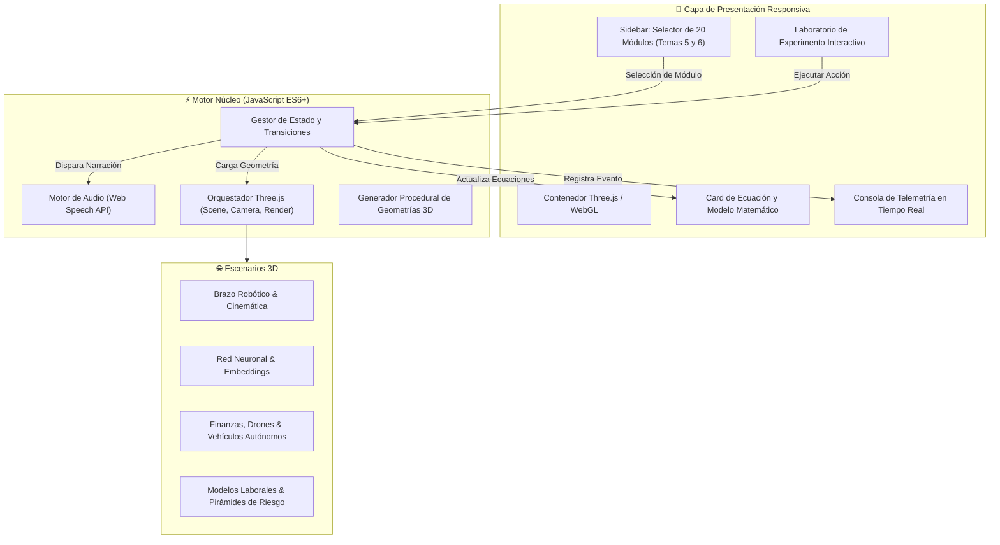

# 🌐 SIMULADOR INTERACTIVO 3D: ÁREAS PRINCIPALES DE LA IA Y SU IMPACTO INDUSTRIAL, ECONÓMICO Y ÉTICO
### *Plataforma Educativa Inmersiva con WebGL, Three.js, Síntesis de Voz y Experimentación en Vivo*

<div align="center">


-green?style=for-the-badge&logo=soundcharts)


**Autor:** Ing. Juancito Peña | **Edición:** Master Architect Pro 2026

[🌐 Ver Demo en Vivo (GitHub Pages)](https://juancitopena.github.io/Simulador-3D-Areas-IA-Impacto-Industrial-Economico-Etico/) • [📚 Catálogo de los 20 Módulos](#-catálogo-completo-de-los-20-módulos) • [🕹️ Cómo Ejecutar](#️-guía-rápida-de-ejecución) • [🧠 Arquitectura Técnica](#-arquitectura-técnica) • [📋 Bitácora de Estado](file:///STATUS_PROYECTO.md)

</div>

---

## 🌟 Descripción General

El **Simulador Interactivo 3D de Áreas de la Inteligencia Artificial y su Impacto** es una plataforma educativa de última generación que materializa, en modelos tridimensionales interactivos acelerados por hardware (**WebGL & Three.js**), la intersección entre las disciplinas técnicas fundamentales de la IA y su impacto transformador en la industria, los mercados financieros, el empleo y los dilemas éticos globales.

Estructurado en dos grandes bloques del conocimiento (**Tema 5: Áreas Principales de la IA** y **Tema 6: Impacto y Aplicaciones Industriales, Económicas y Sociales**), el simulador guía al usuario mediante un sistema de **narración por voz en tiempo real**, demostraciones visuales tridimensionales, modelado matemático formal y un laboratorio de experimentación interactiva con bitácora de eventos en directo.

---

## ✨ Características Principales

- 🎮 **Visualización 3D Dinámica con Three.js (r128)**: Brazo robótico 6-DOF animado, redes neuronales multicapa con pulsos sinápticos, vehículos autónomos con sensor LIDAR simulado, moléculas biónicas, mapas de dispersión financiera y ciudades inteligentes.
- 🎙️ **Narrador Inteligente Sincronizado (Web Speech API)**: Explicaciones pedagógicas detalladas en español que se activan con cada concepto y al disparar experimentos en vivo.
- 📐 **Formalismo Matemático & Ecuaciones en Pantalla**: Cinemática directa ($T = \prod A_i$), transformadas de Fourier ($F(\omega)$), operadores genéticos, capas convolucionales ($S = I * K$), ecuaciones de Black-Scholes y curvas de desplazamiento laboral de Frey & Osborne.
- 🧪 **Laboratorio de Experimentación en Tiempo Real**: Botones de acción dinámica para inducir perturbaciones, ejecutar cinemática inversa, mutar cromosomas, diagnosticar anomalías médicas o simular volatilidades financieras en el canvas 3D.
- ⚡ **Control Total de Simulación**: Ajuste de velocidad (0.5x, 1.0x, 2.0x), selector de voz sintetizada, reinicio instantáneo de cámara orbital y telemetría de consola con marcas de tiempo.
- 📦 **100% Autónomo y Portable**: No requiere servidores Node.js, empaquetadores ni compilación; un único archivo ejecutable localmente o desplegado en la nube vía GitHub Pages.

---

## 📚 Catálogo Completo de los 20 Módulos

### 🔹 Bloque 1: Áreas Principales de la IA (Módulos 01 al 10)

| # | Módulo | Paradigma / Ecuación | Escena 3D | Experimento Interactivo |
|---|--------|----------------------|-----------|-------------------------|
| **01** | **Robótica y Automatización Avanzada** | Cinemática Denavit-Hartenberg $T = \prod A_i(\theta_i)$ | Brazo robótico articulado con efector final | Ejecución de ciclo Pick & Place de alta precisión |
| **02** | **Visión Artificial y Procesamiento de Imágenes** | Convolución 2D $(I * K)(x, y)$ y extracción de bordes | Matriz de píxeles 3D y kernel flotante | Detección de contornos y filtrado gaussiano en vivo |
| **03** | **Algoritmos Genéticos y Optimización Evolutiva** | Selección por torneo, cruce y mutación $P_m$ | Población de cromosomas en doble hélice | Mutación genética y convergencia generacional |
| **04** | **PLN y Procesamiento del Habla** | Embeddings semánticos $\text{sim}(u, v) = \frac{u \cdot v}{\|u\| \|v\|}$ | Espacio vectorial 3D con nubes de tokens | Análisis de sentimiento y proyección semántica |
| **05** | **Redes Neuronales y Deep Learning** | Retropropagación y activación $y = \sigma(W x + b)$ | Red multicapa con pulsos luminosos de gradiente | Feedforward y retropropagación de error |
| **06** | **Agentes Inteligentes y Sistemas Autónomos** | Función de agente $f: P^* \to A$ y ciclo PEAS | Agente sensorial navegando un entorno con metas | Inyección de obstáculos y respuesta adaptativa |
| **07** | **Sistemas Expertos en la Era Moderna** | Base de Conocimiento + Motor de Inferencia Rete | Estructura jerárquica de hechos y reglas interconectadas | Disparo de regla experta ante nuevos axiomas |
| **08** | **Principios de Sistemas Expertos e Integración** | Encadenamiento hacia adelante / atrás (Forward/Backward) | Árbol de derivación lógica con nodos activos | Deducción guiada por metas (Backward Chaining) |
| **09** | **Desarrollo en CLIPS y Plataformas Modernas** | Sintaxis de patrones `(defrule)` y agenda de ejecución | Pila de ejecución de patrones y memoria de trabajo | Activación de reglas CLIPS y resolución de conflictos |
| **10** | **IA en la Creatividad (Arte, Música y Contenido)** | Modelos Difusión y Redes Generativas Adversarias (GAN) | Espacio latente tridimensional interpolando formas | Generación generativa y exploración de vectores latentes |

---

### 🔹 Bloque 2: Impacto Industrial, Económico y Ético (Módulos 11 al 20)

| # | Módulo | Dimensión de Impacto | Escena 3D | Experimento Interactivo |
|---|--------|----------------------|-----------|-------------------------|
| **11** | **Servicios de Datos y Análisis Predictivo** | Modelos predictivos y reducción de dimensionalidad (PCA) | Dispersión multivariada 3D con hiperplano de ajuste | Detección de anomalías en clústeres de datos |
| **12** | **AI & Machine Learning en Empresas** | Automatización Robótica de Procesos (RPA) y ERP | Planta industrial automatizada con líneas de flujo | Optimización de cuellos de botella en tiempo real |
| **13** | **Marketing, Ventas y Finanzas por IA** | Predicción de series temporales y scoring crediticio | Gráficas bursátiles 3D y radar de riesgo crediticio | Simulación de shock de mercado y rebalanceo algorítmico |
| **14** | **Medicina, Biónica y Biotecnología** | Plegamiento de proteínas y diagnóstico por imagen | Estructura proteica / prótesis biónica tridimensional | Detección de patología y adaptación biomecánica |
| **15** | **Transporte Autónomo y Logística Global** | Algoritmos de fusión sensorial (LIDAR, Radar, Cámaras) | Vehículo autónomo en autopista 3D con nubes de puntos | Maniobra de emergencia evasiva en milisegundos |
| **16** | **PLN en Asistentes Virtuales y Atención** | Arquitecturas RAG (Retrieval-Augmented Generation) | Red conversacional canalizando intenciones a respuestas | Consulta de usuario y recuperación de documentos RAG |
| **17** | **IA en Videojuegos, Aviación y Telecomunicaciones** | Árboles de comportamiento y asignación de ancho de banda | Dron aéreo sorteando tráfico y red de antenas 5G | Rutas de vuelo óptimas y gestión de interferencias |
| **18** | **Impacto en el Empleo y Transformación Laboral** | Modelo de tareas rutinarias vs. no cognitivas | Balanza laboral entre empleos automatizados y aumentados | Simulación de re-capacitación laboral en el ecosistema |
| **19** | **Sueldo Básico Universal y Futuro del Trabajo** | Redistribución fiscal del dividendo de productividad de la IA | Gráfico de distribución de renta y amortiguación social | Simulación de inyección de Renta Básica Universal |
| **20** | **Ética, Regulación y Gobernanza de la IA** | Marcos de IA Confiable (EU AI Act, explicabilidad XAI) | Pirámide de riesgo normativo y brújula ética | Auditoría de sesgo algorítmico y caja negra transparente |

---

## 🕹️ Guía Rápida de Ejecución

### Opción 1: Apertura Directa en el Navegador
No se requiere instalar herramientas adicionales. Haz doble clic en el archivo `index.html` o ejecútalo desde PowerShell:

```bash
Start-Process "index.html"
```

### Opción 2: Servidor Local Ligero
Para pruebas locales con servidor HTTP:

```bash
# Con Python 3
python -m http.server 8080

# Con Node.js
npx serve .
```
Abre en tu navegador: `http://localhost:8080`

---

## 🧠 Arquitectura Técnica



---

## 📂 Estructura del Repositorio

```text
Simulador-3D-Areas-IA-Impacto-Industrial-Economico-Etico/
│
├── index.html            # Plataforma web monolítica (Three.js + UI + Síntesis de Voz)
├── README.md             # Documentación exhaustiva y presentación profesional
├── STATUS_PROYECTO.md    # Bitácora de control técnico, auditoría y hoja de ruta
└── .gitignore            # Exclusiones estándar de Git
```

---

## 👨‍💻 Autor y Créditos

- **Desarrollador y Arquitecto:** Ing. Juancito Peña
- **Especialidad:** Arquitectura de Soluciones de Inteligencia Artificial, Analítica de Datos, Visualización Científica e Ingeniería Full-Stack.

---

## 📄 Licencia

Este proyecto está bajo la Licencia **MIT**. Libre para propósitos académicos, pedagógicos, de investigación y demostración tecnológica.
